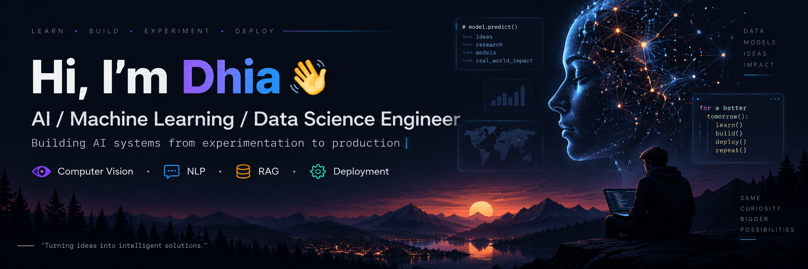
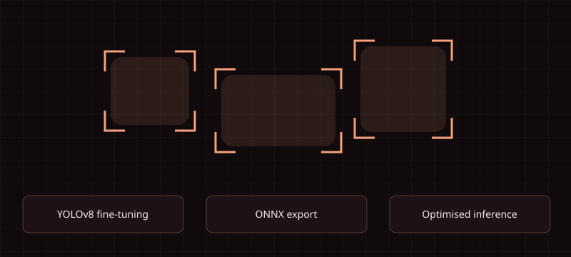
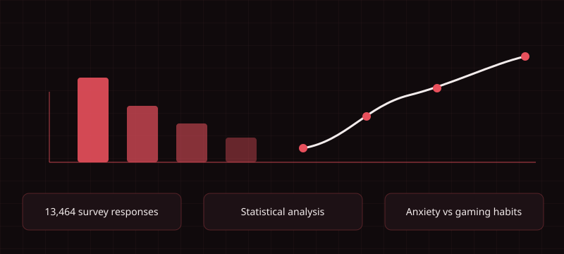
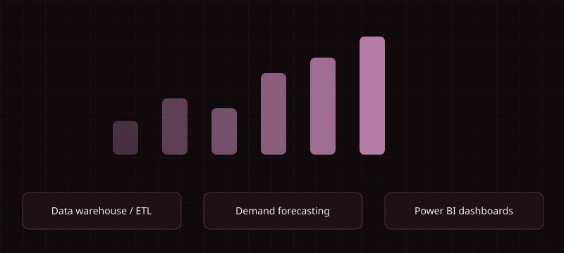
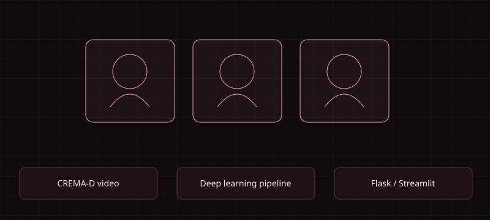
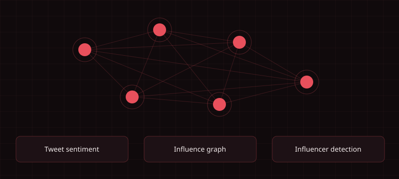

  

# Hi, I'm Dhia Eddine Jedidi 👋

### AI / Machine Learning / Data Science Engineer

Building AI systems that go beyond notebooks — from experimentation and benchmarking to APIs, Docker deployment and production inference.

📍 Bizerte, Tunisia · Open to relocation

---

## 👨‍💻 About Me

I'm an AI/ML Engineer focused on turning machine learning models into usable, production-ready systems.

My experience covers:

- 🧠 Machine Learning & Deep Learning
- 👁️ Computer Vision
- 💬 NLP, Transformers & LLM applications
- 🔎 RAG, Graph-RAG & AI Agents
- ⚙️ Model optimisation and inference
- 🚀 Flask / FastAPI model deployment
- 🐳 Docker-based AI systems
- 📊 Data Engineering, BI & Forecasting

I enjoy working on problems where AI has to perform reliably outside the notebook.

---

## 🚀 What I've Worked On

### 🏭 OctoNorm — Industrial Visual Quality Control

AI-powered visual inspection system developed during my AI Engineering internship at **Octomiro**.

- Replaced approximately **1 hour of manual production stoppage** with **6–10 second inspections per tray**
- Benchmarked **10 AI pipelines**
- Worked with **3,300+ annotated instances**
- Achieved **0.967 AUROC**
- Deployed using **Flask + React + Docker**
- Production inference running on a **V100S GPU server**
- Built a retraining workflow accessible from the operator dashboard

[Demo: Video walkthrough](/assets/demos/octonorm-industrial-visual-quality-control.mp4)
[Demo: Full presentation](https://www.canva.com/design/DAHMHPYnsjM/UDcx2-3up850nXb8qghgPQ/view)

#### From manual inspection to an operator-facing system

OctoNorm addresses industrial visual quality control through AI-powered tray inspections. Developed during my AI Engineering internship at Octomiro, it connects model benchmarking with a deployed application that operators can use.

The implementation combines Flask, React and Docker, with production inference on a V100S GPU server. A retraining workflow is accessible from the operator dashboard, bringing model updates into the same application used for inspection.

---

### 📄 OCR + BERT Document Classification

Developed during my internship at **El Fouladh**.

- OCR + BERT document classification pipeline
- Achieved **96% accuracy**
- Exposed through a **Flask REST API**
- Automated document routing
- Reduced processing time by approximately **90%**

[Live Demo](https://www.linkedin.com/feed/update/urn:li:activity:7372196138487287808/)

#### From documents to automated routing

This project combines OCR with a BERT document classification pipeline, developed during my internship at El Fouladh. The pipeline supports automated document routing, connecting document processing with classification.

A Flask REST API exposes the pipeline for application integration. The reported results cover both classification quality and document processing time, as listed below.

---

### 🎮 BGA X-Ray Defect Detection

Developed during my final-year internship (Applied Mathematics: Data Science) at **MPSI** (Maintenance Partner Solutions International), a Sony PlayStation after-sales service and refurbishment subcontractor in Tunisia.

- Deep-learning classifier for X-ray images of BGA components on PlayStation boards, detecting solder-ball short circuits ("CC billes") on the SoC
- Dataset provided by MPSI: **720 X-ray images** (375 normal, 355 short-circuit), expanded to **5,439 images** with data augmentation
- Compared pre-trained CNNs and selected **VGG16**, tuned for 20 epochs, the Adam optimizer and a 0.0001 learning rate
- Data augmentation lifted test accuracy from about **64% to about 94%**
- Delivered as a web application where operators upload an X-ray image and get a result, with test history, supervisor and administrator roles

`Python` · `TensorFlow` · `Keras` · `VGG16` · `Jupyter Notebook`

#### From manual X-ray inspection to automatic detection

MPSI repairs and refurbishes electronic boards, including PlayStation consoles, and checks BGA (ball grid array) components with X-ray imaging. The goal of this internship was a fast, easy-to-use model that detects defects automatically and reduces human intervention in the inspection step. The work focused on the short-circuit case on the SoC.

The pipeline preprocesses the X-ray images (border and corner cropping, artifact removal with histogram equalization and region-of-interest handling, resizing), then classifies them with a transfer-learned CNN. Several pre-trained architectures were compared, and VGG16 gave the highest accuracy and lowest loss. Training on the augmented dataset raised test accuracy from 0.638 to 0.94, with a test loss falling from 0.98 to 0.23.

The model was then wrapped in a web application designed with UML use-case and sequence diagrams. Workers test a component by submitting its X-ray image and name and can review the history of saved tests, supervisors check their decisions, and administrators manage the component database.

---

### 🎯 YOLOv8 Object Detection

Freelance AI project focused on model optimisation.

- Fine-tuned YOLOv8
- Improved mAP from **0.72 → 0.91**
- Exported and optimised inference using ONNX
- Reduced inference latency by **45%**

#### Fine-tuning and inference optimisation

This freelance project focused on optimising a YOLOv8 object detection model. The work included fine-tuning the model and exporting it to ONNX for optimised inference.

The project evaluated both detection quality, measured by mAP, and inference latency. This connects model training improvements with the speed of running the model.

---

## 🔬 Featured Projects

### 🎮 Gaming Anxiety Data Analysis

`Python` · `Jupyter Notebook` · `Pandas` · `Plotly` · `scikit-learn`

- Statistical analysis of anxiety metrics from an online gaming survey
- Explored how gaming habits relate to anxiety levels
- Visualizations of the findings and a discussion of possible interventions
- Dataset of **13,464 respondents** and **55 variables**

[GitHub](https://github.com/dhiaeddinejedidi/GamingBehavior)
[Live Demo](https://www.linkedin.com/posts/dhia-eddine-jedidi-76927222b_datascience-gaminganxiety-mentalhealth-ugcPost-7217638928781033472-vzAq/)
[Kaggle Notebook](https://www.kaggle.com/code/dhia0208/gaming-anxiety)

#### Understanding the link between gaming and anxiety

This data science project examines how gaming habits relate to anxiety. It is built in a Jupyter notebook on the public Online Gaming Anxiety dataset from Kaggle, which combines standardized questionnaires (GAD-7 anxiety, Satisfaction With Life and social phobia scales) with details about what, how long and why people play, plus demographics.

The analysis covers the dataset's structure and missing values, descriptive statistics, a correlation heatmap and distribution charts for variables such as age and gender. The sample is young (mean age about 21) and mostly male, which shapes how far the results can be generalized. The notebook closes with thoughts on possible interventions.

The project was published on GitHub and Kaggle and shared on LinkedIn. It strengthened my practical skills in data cleaning, statistical analysis and data visualization.

---

### 📊 BI & Analytics Platform

`PostgreSQL` · `Talend` · `Python` · `Power BI` · `Flask` · `Angular`

- Data warehouse for supply-chain analytics
- Automated ETL pipelines
- ML/DL demand forecasting
- Interactive Power BI dashboards

[Live Demo](https://www.linkedin.com/feed/update/urn:li:ugcPost:7331246649878454272/)

#### Connecting supply-chain data with forecasting

This platform brings together a supply-chain analytics data warehouse, automated ETL pipelines, demand forecasting and interactive dashboards. Its technology stack includes PostgreSQL, Talend, Python, Power BI, Flask and Angular.

Machine learning and deep learning are used for demand forecasting, while Power BI dashboards present the analytics interactively. The project spans data preparation, forecasting and presentation.

---

### 🎥 Video Emotion Recognition

`PyTorch` · `OpenCV` · `3D CNN` · `Autoencoder` · `LSTM` · `Attention`

Built a multi-stage deep learning pipeline for video emotion recognition using the CREMA-D dataset, exposed through a Flask API with a Streamlit webcam interface.

#### A video model with an interactive interface

This project uses the CREMA-D dataset in a multi-stage deep learning pipeline for video emotion recognition. The documented stack includes PyTorch, OpenCV, 3D CNN, autoencoder, LSTM and attention components.

The pipeline is exposed through a Flask API and paired with a Streamlit webcam interface. This makes the project more than a training experiment: it includes an interface for interacting with the video emotion recognition pipeline.

---

### 🌐 Twitter Influence Graph Analysis

`BERTweet` · `GNN` · `Graph-RAG` · `PyTorch Geometric`

- Sentiment analysis on **1.6M tweets**
- **92% sentiment classification accuracy**
- Influence graph containing 150K nodes and 500K edges
- Applied GNNs and Graph-RAG for influencer detection

#### Combining sentiment with graph-based analysis

This project combines tweet sentiment analysis with an influence graph for influencer detection. Its documented stack includes BERTweet, GNNs, Graph-RAG and PyTorch Geometric.

Sentiment analysis covers 1.6 million tweets, and the influence graph contains 150,000 nodes and 500,000 edges. GNNs and Graph-RAG are applied to influencer detection, connecting language analysis with relationships represented in the graph.

---

## 🧠 AI & Machine Learning Stack

### Machine Learning

### Deep Learning

### Generative AI

### Deployment & MLOps

### Data & BI

---

## 📈 GitHub Stats

---

## 🔥 GitHub Streak

---

## 🎓 Education

**Engineering Degree in Computer Science — Data Science Track**  
ESPRIT, Tunis · Expected 2026

**BSc Applied Mathematics — Data Science**  
FST, University of Tunis El Manar · 2020–2023

---

## 📜 Certifications

- NVIDIA — Fundamentals of Deep Learning
- NVIDIA — AI for Predictive Maintenance
- NVIDIA — Transformer-Based NLP Applications
- IBM — Deep Learning with PyTorch
- AWS — Cloud Foundations
- The Hashgraph Association — Hashgraph Developer Course

---

## 🌍 Languages

🇹🇳 Arabic — Native  
🇫🇷 French — B2  
🇬🇧 English — B2

---

### 🤝 Let's Connect

I'm interested in opportunities in **AI Engineering, Machine Learning, Computer Vision, NLP, Generative AI and Data Science**.

[LinkedIn](https://linkedin.com/in/dhia-eddine-jdidi) ·
[GitHub](https://github.com/Dhaw208)

